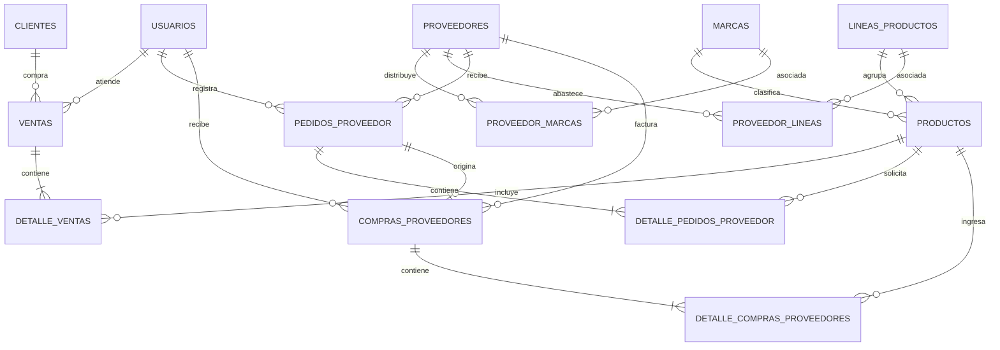

# 02 — Base de datos

> Modelo físico actual implementado en **Supabase** (PostgreSQL 17, proyecto `back_tofor`), junto con la sección de sugerencias de evolución a futuro.

## 1. Diagrama entidad-relación actual (Supabase)

---

## 2. Tablas actuales en la base de datos (14 tablas)

### 2.1 Usuarios y Seguridad

#### `usuarios`
Gestiona el personal y los niveles de autorización de la librería.

| Columna | Tipo de dato | Restricción | Descripción |
|---|---|---|---|
| `id_usuario` | `integer` | PK, Identity | Identificador único del usuario |
| `nombre_completo` | `varchar` | NOT NULL | Nombre y apellidos del usuario |
| `username` | `varchar` | UNIQUE, NOT NULL | Nombre de usuario para login |
| `password_hash` | `varchar` | NOT NULL | Contraseña cifrada con hash (`bcryptjs`) |
| `rol` | `tipo_rol` (ENUM) | NOT NULL | `SUPER_ADMIN`, `ADMIN`, `VENDEDOR` |
| `turno` | `tipo_turno` (ENUM) | NOT NULL | `mañana`, `tarde`, `tiempo_completo` |
| `estado` | `boolean` | DEFAULT `true` | Estado activo/inactivo (borrado lógico) |

---

### 2.2 Catálogo y Clasificación

#### `marcas`
| Columna | Tipo de dato | Restricción | Descripción |
|---|---|---|---|
| `id_marca` | `integer` | PK, Serial | Identificador de la marca (ej: Faber-Castell, Pilot, Artesco) |
| `nombre_marca` | `varchar` | UNIQUE, NOT NULL | Nombre comercial de la marca |

#### `lineas_productos`
| Columna | Tipo de dato | Restricción | Descripción |
|---|---|---|---|
| `id_linea` | `integer` | PK, Serial | Identificador de la línea (ej: Cuadernos, Adhesivos, Pinturas) |
| `nombre_linea` | `varchar` | UNIQUE, NOT NULL | Nombre de la línea o subcategoría |

#### `productos`
| Columna | Tipo de dato | Restricción | Descripción |
|---|---|---|---|
| `id_producto` | `integer` | PK, Identity | Identificador único del producto |
| `codigo_barras` | `varchar` | UNIQUE, NULLABLE | Código de barras o SKU del artículo |
| `nombre_producto` | `varchar` | NOT NULL | Nombre y descripción del artículo |
| `precio_minorista` | `numeric` | NOT NULL | Precio de venta al detalle |
| `precio_mayorista` | `numeric` | NOT NULL | Precio preferencial para pequeñas librerías |
| `stock_actual` | `integer` | DEFAULT `0` | Unidades disponibles en tienda/depósito |
| `stock_minimo` | `integer` | DEFAULT `5` | Umbral para alerta de reposición |
| `estado` | `boolean` | DEFAULT `true` | Estado activo/inactivo |
| `id_marca` | `integer` | FK -> `marcas` (NULLABLE) | Marca del producto |
| `id_linea` | `integer` | FK -> `lineas_productos` (NULLABLE) | Línea o rubro al que pertenece |

---

### 2.3 Proveedores y Relaciones N:M

#### `proveedores`
| Columna | Tipo de dato | Restricción | Descripción |
|---|---|---|---|
| `id_proveedor` | `integer` | PK, Identity | Identificador del proveedor |
| `nit` | `varchar` | NOT NULL | NIT o cédula comercial |
| `razon_social` | `varchar` | NOT NULL | Razón social o nombre comercial |
| `nombre_contacto` | `varchar` | NULLABLE | Persona de contacto/preventista |
| `telefono_contacto` | `varchar` | NULLABLE | Teléfono o celular de contacto |
| `ciudad` | `varchar` | NULLABLE | Ciudad (La Paz, El Alto, Cochabamba, etc.) |
| `estado` | `boolean` | DEFAULT `true` | Estado activo/inactivo |

#### `proveedor_marcas` (Tabla intermedia)
| Columna | Tipo de dato | Restricción | Descripción |
|---|---|---|---|
| `id_proveedor` | `integer` | PK, FK -> `proveedores` | Proveedor que distribuye la marca |
| `id_marca` | `integer` | PK, FK -> `marcas` | Marca distribuida |

#### `proveedor_lineas` (Tabla intermedia)
| Columna | Tipo de dato | Restricción | Descripción |
|---|---|---|---|
| `id_proveedor` | `integer` | PK, FK -> `proveedores` | Proveedor que abastece la línea |
| `id_linea` | `integer` | PK, FK -> `lineas_productos` | Línea de producto abastecida |

---

### 2.4 Clientes

#### `clientes`
| Columna | Tipo de dato | Restricción | Descripción |
|---|---|---|---|
| `id_cliente` | `integer` | PK, Identity | Identificador del cliente |
| `razon_social_nombre` | `varchar` | NOT NULL | Nombre de la persona o negocio |
| `nit_ci` | `varchar` | NOT NULL | NIT o número de cédula |
| `telefono` | `varchar` | NULLABLE | Teléfono de contacto |
| `direccion` | `text` | NULLABLE | Dirección física o zona |
| `tipo_cliente` | `varchar` | DEFAULT `'Mayorista'` | Clasificación (`Mayorista`, `Minorista`) |
| `estado` | `boolean` | DEFAULT `true` | Estado activo/inactivo |

---

### 2.5 Pedidos y Compras a Proveedores

#### `pedidos_proveedor`
Registra la orden o nota de pedido enviada al proveedor antes de la entrega.

| Columna | Tipo de dato | Restricción | Descripción |
|---|---|---|---|
| `id_pedido` | `integer` | PK, Identity | Identificador de la orden de pedido |
| `id_proveedor` | `integer` | FK -> `proveedores` | Proveedor solicitado |
| `id_usuario` | `integer` | FK -> `usuarios` | Usuario/vendedor que elaboró el pedido |
| `fecha_pedido` | `timestamp` | NOT NULL | Fecha y hora de emisión del pedido |
| `fecha_entrega_estimada`| `date` | NULLABLE | Fecha pactada con el preventista |
| `total_pedido` | `numeric` | DEFAULT `0.00` | Monto total estimado |
| `estado_pedido` | `varchar` | DEFAULT `'Pendiente'` | `Pendiente`, `Recibido`, `Cancelado` |

#### `detalle_pedidos_proveedor`
| Columna | Tipo de dato | Restricción | Descripción |
|---|---|---|---|
| `id_detalle_pedido` | `integer` | PK, Identity | Identificador del ítem |
| `id_pedido` | `integer` | FK -> `pedidos_proveedor` | Pedido al que pertenece |
| `id_producto` | `integer` | FK -> `productos` | Producto solicitado |
| `cantidad_solicitada` | `integer` | NOT NULL | Cantidad de unidades/paquetes pedidos |
| `unidad_venta` | `varchar` | NOT NULL | Unidad (Pieza, Docena, Caja, Paquete) |
| `precio_unitario_compra` | `numeric` | NOT NULL | Precio cotizado por unidad |
| `porcentaje_descuento` | `numeric` | DEFAULT `0.00` | Descuento acordado |
| `subtotal` | `numeric` | NOT NULL | Monto subtotal calculado |

#### `compras_proveedores`
Registra la recepción real y facturada de mercadería en tienda o almacén.

| Columna | Tipo de dato | Restricción | Descripción |
|---|---|---|---|
| `id_compra` | `integer` | PK, Identity | Identificador de la compra/recepción |
| `id_pedido` | `integer` | FK -> `pedidos_proveedor` (NULLABLE) | Pedido origen (si existió orden previa) |
| `id_proveedor` | `integer` | FK -> `proveedores` | Proveedor que entrega |
| `id_usuario` | `integer` | FK -> `usuarios` | Usuario que recepciona la mercadería |
| `fecha_recepcion` | `timestamp` | NOT NULL | Fecha y hora en la que ingresó el stock |
| `total_pagado` | `numeric` | NOT NULL | Monto total de la compra |

#### `detalle_compras_proveedores`
| Columna | Tipo de dato | Restricción | Descripción |
|---|---|---|---|
| `id_detalle_compra` | `integer` | PK, Identity | Identificador del ítem recibido |
| `id_compra` | `integer` | FK -> `compras_proveedores` | Compra a la que pertenece |
| `id_producto` | `integer` | FK -> `productos` | Producto que entra al inventario |
| `cantidad_recibida` | `integer` | NOT NULL | Cantidad real verificada físicamente |
| `precio_costo_unitario` | `numeric` | NOT NULL | Costo de adquisición real |
| `subtotal` | `numeric` | NOT NULL | Subtotal de la línea de compra |

---

### 2.6 Ventas

#### `ventas`
Registra las transacciones comerciales en mostrador o ventas al por mayor.

| Columna | Tipo de dato | Restricción | Descripción |
|---|---|---|---|
| `id_venta` | `integer` | PK, Identity | Identificador de la venta |
| `id_usuario` | `integer` | FK -> `usuarios` | Vendedor que atendió la venta |
| `id_cliente` | `integer` | FK -> `clientes` (NULLABLE) | Cliente asignado (o nulo para minorista anónimo) |
| `fecha_hora` | `timestamp` | NOT NULL | Fecha y hora de la transacción |
| `tipo_venta` | `varchar` | NOT NULL | `Minorista`, `Mayorista` |
| `metodo_pago` | `varchar` | NOT NULL | `Efectivo`, `QR`, `Mixto` |
| `monto_total` | `numeric` | NOT NULL | Importe total a cobrar |
| `monto_efectivo` | `numeric` | NULLABLE | Monto entregado en efectivo por el cliente |
| `monto_cambio` | `numeric` | NULLABLE | Cambio o vuelto entregado |
| `estado_pago_qr` | `varchar` | NULLABLE | Estado de verificación del QR (`Confirmado`, `Pendiente`) |

#### `detalle_ventas`
| Columna | Tipo de dato | Restricción | Descripción |
|---|---|---|---|
| `id_detalle_venta` | `integer` | PK, Identity | Identificador del ítem vendido |
| `id_venta` | `integer` | FK -> `ventas` | Venta asociada |
| `id_producto` | `integer` | FK -> `productos` | Producto vendido |
| `cantidad` | `integer` | NOT NULL | Cantidad de unidades vendidas |
| `precio_aplicado` | `numeric` | NOT NULL | Precio unitario cobrado (según tipo de cliente) |
| `subtotal` | `numeric` | NOT NULL | Subtotal (`cantidad * precio_aplicado`) |

---

## 3. Sugerencias de evolución y cambios futuros

Las siguientes tablas y columnas formaban parte de la propuesta inicial o responden a necesidades operativas de la librería que aún no han sido aplicadas a la base de datos de Supabase. Se documentan aquí como sugerencias de ampliación:

### 3.1 Módulo de Caja y Arqueo (Pendiente de implementación)

Actualmente las ventas no están asociadas al turno de una caja física. Para permitir el cuadre diario y cierre de turno de los 7 vendedores se sugiere crear:

* **Tabla `cajas`**:
  * `id_caja` (PK, Serial)
  * `id_usuario` (FK -> `usuarios`)
  * `fecha_apertura` (timestamp), `fecha_cierre` (timestamp, nullable)
  * `monto_inicial` (numeric)
  * `estado` (varchar: `ABIERTA`, `CERRADA`)
* **Tabla `arqueos`**:
  * `id_arqueo` (PK, Serial)
  * `id_caja` (FK -> `cajas`, UNIQUE)
  * `efectivo_esperado`, `efectivo_contado` (numeric)
  * `qr_esperado`, `qr_registrado` (numeric)
  * `diferencia` (numeric), `observaciones` (text)
* **Campo sugerido en `ventas`**:
  * `id_caja` (`integer`, FK -> `cajas`, nullable temporalmente): Para asegurar que una venta solo se emita si existe una caja abierta para ese vendedor.

### 3.2 Kardex y Movimientos de Inventario (Pendiente de implementación)

Actualmente el inventario se actualiza modificando directamente `productos.stock_actual`, lo que no deja trazabilidad en caso de mermas o pérdidas. Se sugiere incorporar:

* **Tabla `movimientos_inventario`**:
  * `id_movimiento` (PK, Identity)
  * `id_producto` (FK -> `productos`)
  * `tipo` (ENUM / varchar: `COMPRA`, `VENTA`, `BAJA`, `AJUSTE`)
  * `cantidad` (integer, positivo o negativo)
  * `stock_resultante` (integer)
  * `motivo` (varchar: venta mostrador, compra proveedor, producto vencido/secado, error de conteo)
  * `referencia_id` (integer, nullable: `id_venta` o `id_compra`)
  * `id_usuario` (FK -> `usuarios`)
  * `fecha` (timestamp)

### 3.3 Desacoplamiento de Pagos Mixtos (Pendiente de implementación)

Actualmente `ventas` contiene columnas directas para efectivo y QR (`monto_efectivo`, `estado_pago_qr`). Si un cliente mayorista paga una parte en efectivo y otra mediante QR de banco, una tabla de pagos desacoplada facilitará el arqueo:

* **Tabla `pagos` (Opcional a futuro)**:
  * `id_pago` (PK, Identity)
  * `id_venta` (FK -> `ventas`)
  * `metodo_pago` (varchar: `EFECTIVO`, `QR`)
  * `monto` (numeric)
  * `referencia_qr` (varchar, nullable)
  * `fecha_pago` (timestamp)

### 3.4 Atributos sugeridos en Catálogo de Productos

* `perecible` (`boolean`, DEFAULT `false`): Para clasificar productos con fecha límite de uso (adhesivos, siliconas líquidas, témperas, pinturas) y alertar sobre mermas.
* `precio_compra` o `costo_promedio` (`numeric`): Para conocer el margen bruto de utilidad de cada artículo directamente en el catálogo sin tener que consultar la última compra.
